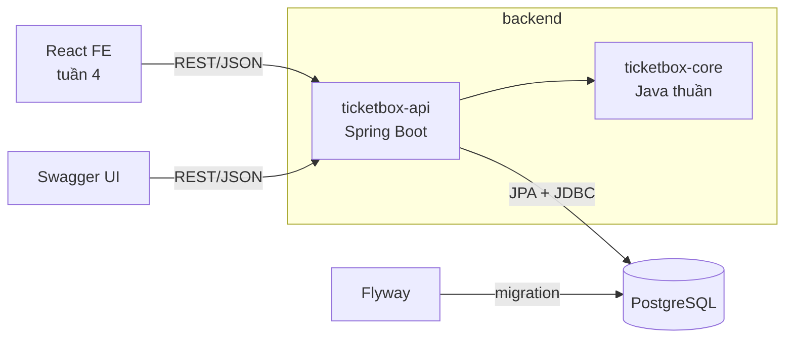
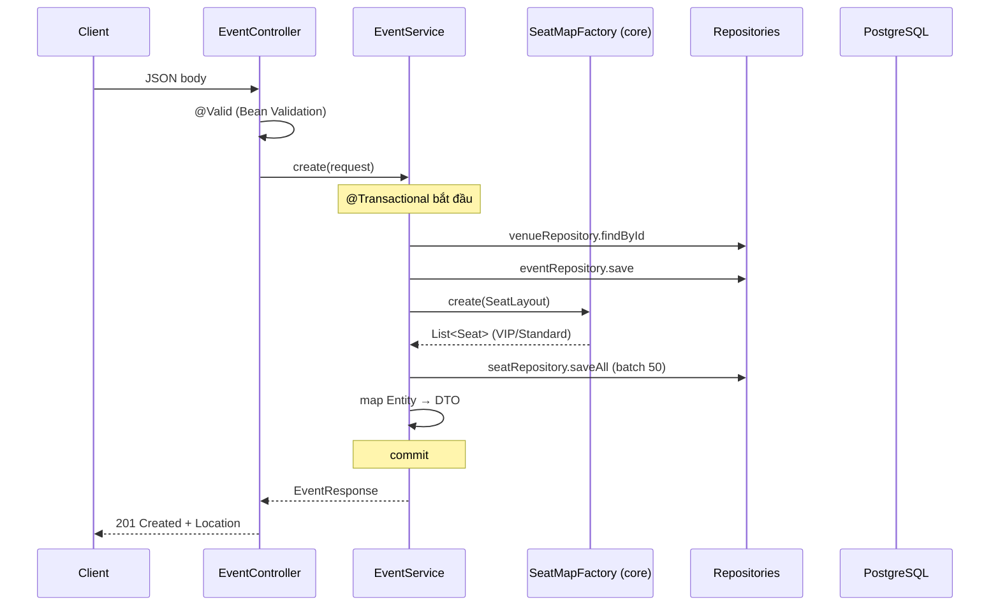

# Kiến trúc

## 1. Tổng thể

Monolith dạng **modular**: một ứng dụng Spring Boot, nhưng logic nghiệp vụ thuần nằm ở module riêng
không phụ thuộc framework.



| Module | Chứa gì | Phụ thuộc |
|---|---|---|
| `ticketbox-core` | Domain model, rule (trạng thái ghế, giá VIP, sinh sơ đồ ghế), exception, service in-memory tuần 1 | Chỉ JDK |
| `ticketbox-api` | REST, JPA entity, repository, transaction, validation, xử lý lỗi | core + Spring |

**Vì sao tách?** Rule nghiệp vụ test được không cần Spring/DB (nhanh), và tuần 2 dùng lại đúng các rule đã viết
ở tuần 1 (`SeatMapFactory`, `SeatStatus`, `VipSeat.price()`, exception). Xem ADR-001.

## 2. Cấu trúc package

```
ticketbox-core/src/main/java/com/noah/ticketbox/core
├── common/        Identifiable, IdGenerator, Result<T>
├── domain/        Event, Seat (+StandardSeat, VipSeat), SeatPosition, SeatLayout, Booking, enums, SeatMapFactory
├── pricing/       PricingStrategy
├── repository/    Repository<T, ID>, InMemoryRepository
├── exception/     ErrorCode, BusinessException và các lớp con
├── service/       EventService, BookingService, ReportService
└── demo/          Week1DemoApp

ticketbox-api/src/main/java/com/noah/ticketbox/api
├── common/
│   ├── config/       CoreBeansConfig, OpenApiConfig
│   ├── persistence/  BaseEntity
│   └── web/          GlobalExceptionHandler, PageResponse
├── venue/         VenueEntity, VenueRepository, VenueController, VenueResponse
├── event/         EventEntity, EventRepository, EventSpecifications, EventService, EventMapper, EventController, dto/
├── seat/          SeatEntity, SeatRepository, SeatService, SeatController, dto/
└── report/        RevenueReportRepository (JdbcTemplate), ReportController
```

**Package by feature** (thay vì `controller/`, `service/`, `repository/` chung): mọi thứ của "event"
nằm cạnh nhau, dễ tìm, dễ xóa, dễ tách module sau này. Bên trong mỗi feature vẫn phân lớp rõ ràng.

## 3. Luồng một request

Ví dụ `POST /api/v1/events`:



Lỗi ở bất kỳ bước nào → exception → `GlobalExceptionHandler` → ProblemDetail JSON (xem `API.md`).

## 4. Trách nhiệm từng lớp

| Lớp | Làm | Không làm |
|---|---|---|
| Controller | Nhận/trả HTTP, `@Valid`, chọn status code | Rule nghiệp vụ, gọi repository |
| Service | Use case, transaction, phối hợp repository, map DTO | Biết về HTTP |
| Entity / Domain | Giữ trạng thái, bảo vệ rule (`publish()`, `hold()`) | Truy cập DB |
| Repository | Truy vấn dữ liệu | Rule nghiệp vụ |

## 5. Concurrency theo từng tuần

| Tuần | Cơ chế | Giới hạn |
|---|---|---|
| 1 | `ReentrantLock` theo từng event, trong JVM | Chỉ đúng khi chạy 1 instance |
| 3 | `@Version` optimistic lock trên bảng `seat` | Nhiều xung đột → nhiều request bị `409` (chấp nhận được với bán vé) |
| 3 ⭐ | `SELECT ... FOR UPDATE` để so sánh | Giữ lock lâu hơn, có thể chờ |
