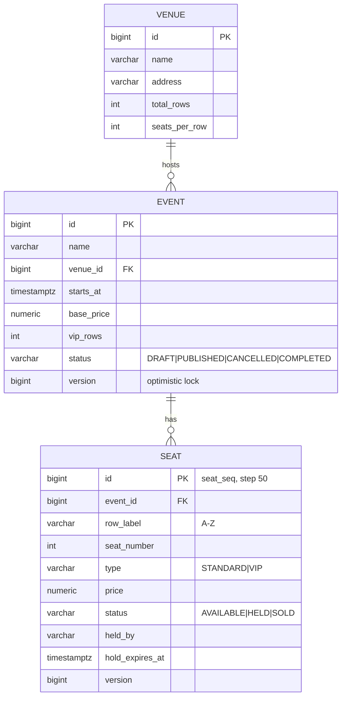

# Database

PostgreSQL 16, schema quản lý bằng Flyway. Hibernate chỉ `validate`.

## ERD (tuần 2)

Tuần 3 thêm: `app_user`, `booking`, `booking_seat`, `payment_event`, `ticket`.

## Ghi chú thiết kế

| Điểm | Lý do |
|---|---|
| Mỗi event có bản sao ghế riêng | Trạng thái ghế thuộc về từng suất diễn, không thuộc về địa điểm |
| `price` lưu trên từng ghế | Giá chốt tại thời điểm tạo, đổi giá cơ bản không ảnh hưởng ghế cũ |
| `UNIQUE (event_id, row_label, seat_number)` | DB tự chặn ghế trùng, kể cả khi code có bug |
| `CHECK` cho status | Dữ liệu sai không thể vào DB |
| `ck_seat_hold` | Ghế HELD bắt buộc có người giữ và hạn giữ |
| `TIMESTAMPTZ` | Lưu thời điểm tuyệt đối, tránh lỗi múi giờ |
| `NUMERIC(12,0)` | Tiền VND, không dùng float |
| `version` | Optimistic locking (dùng thật ở tuần 3) |

## Index

| Index | Phục vụ query | Ghi chú |
|---|---|---|
| `uq_seat_event_position` | Ghế của một event | Tạo tự động từ unique constraint |
| `ix_event_venue_id` | Join event-venue | PostgreSQL **không** tự index FK |
| `ix_event_status_starts_at` | Danh sách event theo status + khoảng ngày | Cột so sánh bằng đứng trước, cột range đứng sau |
| `ix_seat_held_expires_at` (partial) | Job nhả ghế hết hạn | Chỉ index dòng `HELD`, rất nhỏ |

Số đo trước/sau: `BENCHMARK.md`.

## Migration

| File | Thư mục | Nội dung |
|---|---|---|
| `V1__init_schema.sql` | `db/migration` | Bảng venue, event, seat, sequence |
| `V1_1__seed_demo_data.sql` | `db/seed` (chỉ `dev`) | 3 venue, 1.000 event, ~300.000 ghế |
| `V2__add_query_indexes.sql` | `db/migration` | Index ở bảng trên |

**Quy tắc:**
1. Không sửa file đã chạy. Flyway lưu checksum trong `flyway_schema_history`, sửa sẽ báo lỗi.
2. Thay đổi tương thích ngược: thêm cột cho phép null hoặc có default trước, backfill, rồi mới thêm `NOT NULL`.
3. Muốn làm lại DB local từ đầu: `docker compose down -v && docker compose up -d`.
