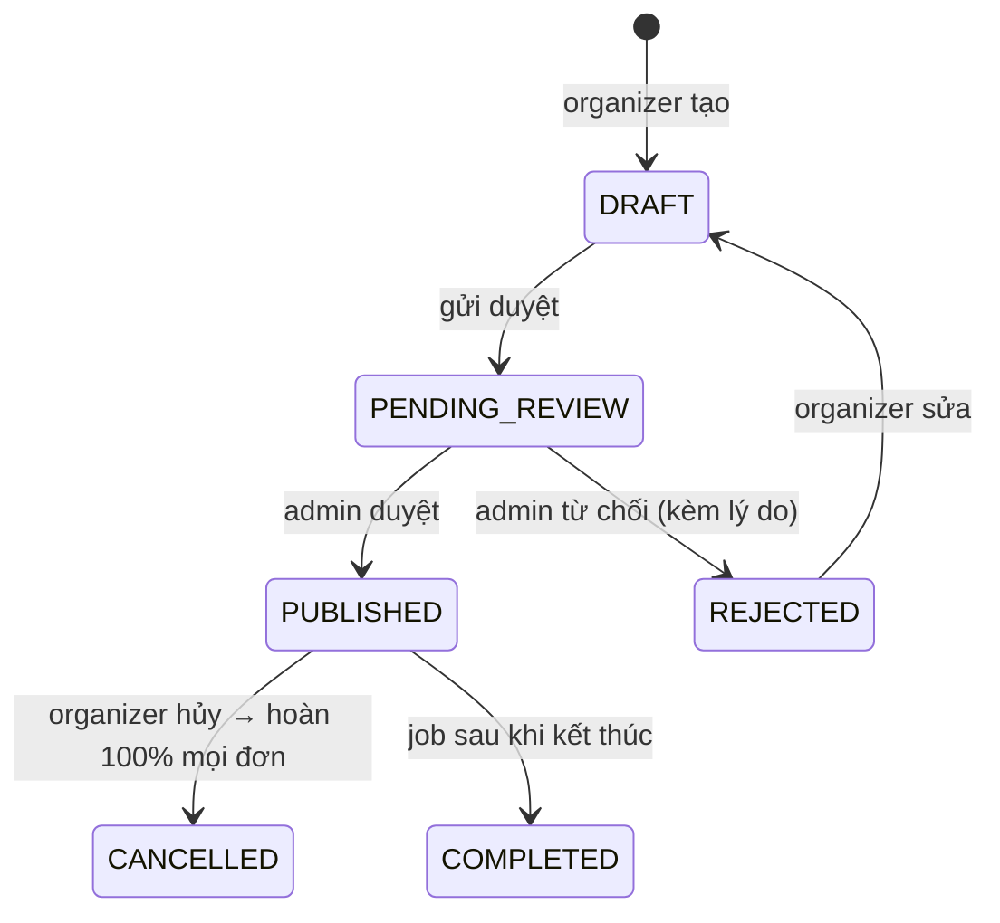
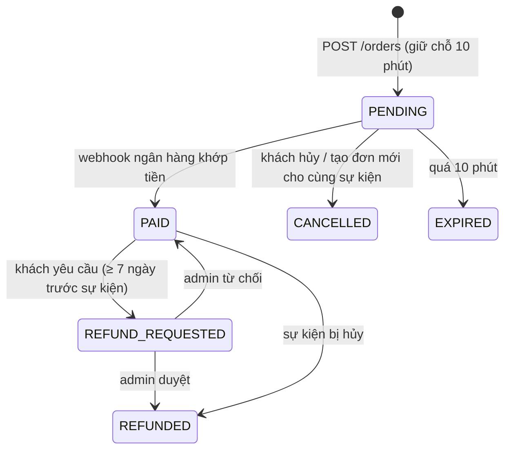
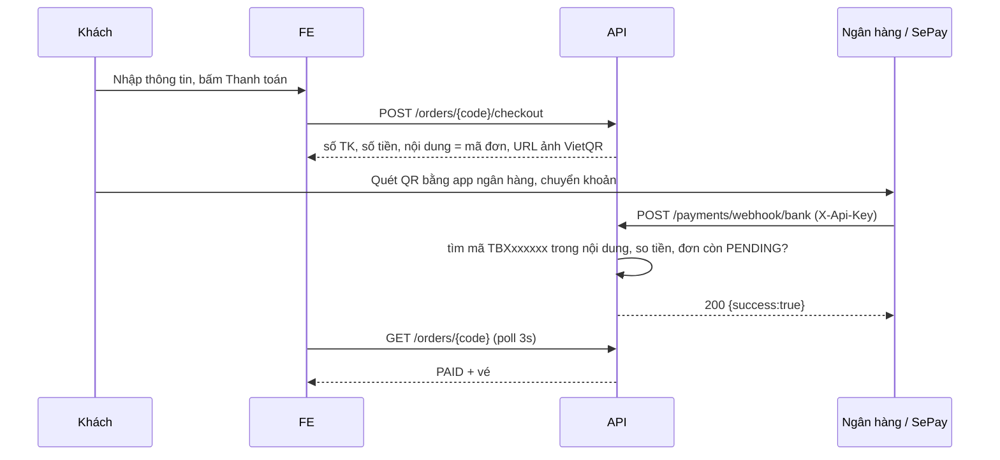

# Nghiệp vụ (Domain)

Tài liệu này là **nguồn sự thật về nghiệp vụ**. Backend phải làm đúng các quy tắc ở đây; mock MSW ở frontend
(`frontend/src/mocks`) đã cài đặt y hệt để làm mẫu. Mọi con số cấu hình nằm ở `frontend/src/lib/rules.ts`
và sẽ có bản tương ứng ở backend (`application.yml` → `ticketbox.booking.*`).

## 1. Vai trò

| Vai trò | Làm được gì | Khu vực FE |
|---|---|---|
| **Khách vãng lai** | Xem sự kiện, xem sơ đồ ghế | `/`, `/events/:id` |
| **CUSTOMER** | Giữ chỗ, thanh toán, xem vé, yêu cầu hoàn vé | `/checkout`, `/me/*` |
| **ORGANIZER** | Tạo/sửa sự kiện nháp, gửi duyệt, hủy sự kiện, xem doanh thu, tạo mã giảm giá | `/organizer/*` |
| **STAFF** | Check-in vé tại cổng cho sự kiện được phân công | `/staff` |
| **ADMIN** | Duyệt sự kiện, xử lý hoàn tiền, đối soát chuyển khoản, quản lý người dùng; check-in mọi sự kiện | `/admin/*`, `/staff` |

Phân quyền **luôn kiểm tra ở backend** (`@PreAuthorize`). Route guard ở FE chỉ để trải nghiệm tốt hơn.

## 2. Vòng đời sự kiện

| Quy tắc | Chi tiết |
|---|---|
| Chỉ sửa khi DRAFT/REJECTED | Đã mở bán thì không đổi giá, sơ đồ ghế (tránh tranh chấp với người đã mua) |
| Thời gian hợp lệ | `saleStartsAt < saleEndsAt ≤ startsAt < endsAt`, `startsAt` ở tương lai |
| Khách chỉ thấy | PUBLISHED (đang bán), COMPLETED, CANCELLED. DRAFT/PENDING/REJECTED chỉ organizer sở hữu và admin xem được |
| Hủy sự kiện | Mọi đơn PAID/REFUND_REQUESTED → REFUNDED 100% (kể cả phí dịch vụ), đơn PENDING → CANCELLED |

## 3. Hạng vé và hình thức chỗ ngồi

- **RESERVED** (chọn ghế): mỗi hạng vé (ticket type) phủ một dải hàng, ví dụ VIP = A–B, Standard = C–L.
  Hàng không thuộc hạng nào thì không bán. Ghế có thể **BLOCKED** (vị trí máy quay, bàn âm thanh).
- **GENERAL_ADMISSION** (vé tự do): mỗi hạng có `quota`; tổng quota ≤ sức chứa địa điểm.
- Địa điểm không có sơ đồ ghế (`totalRows = 0`) chỉ tổ chức được GA.
- `maxPerOrder` theo từng hạng (ví dụ Courtside tối đa 2).

> So với tuần 1–2 (`STANDARD`/`VIP` cố định, VIP = 1.5x), tuần 3 chuyển sang **ticket_type** do organizer tự định nghĩa.
> Đây là mô hình của các nền tảng thật (Ticketbox, Eventbrite). Xem ADR-013.

## 4. Đặt vé (hold) — phần cốt lõi

Kiểm tra khi `POST /orders`, **theo thứ tự rẻ → đắt**:

| # | Kiểm tra | Lỗi |
|---|---|---|
| 1 | Đăng nhập, role CUSTOMER, tài khoản không bị khóa | 401 / 403 |
| 2 | Sự kiện PUBLISHED | 409 `INVALID_STATE` |
| 3 | Trong khung giờ bán | 422 `SALE_NOT_OPEN` / `SALE_CLOSED` |
| 4 | Hủy đơn PENDING cũ của chính user cho sự kiện này (1 hold/user/sự kiện) | — |
| 5 | ≤ 8 vé/đơn, ≤ `maxPerOrder` mỗi hạng | 422 `LIMIT_EXCEEDED` |
| 6 | Tổng vé user đã mua cho sự kiện + đơn mới ≤ 8 (chống phe vé) | 422 `PURCHASE_LIMIT` |
| 7 | **Còn ghế/còn quota** — phần tranh chấp, làm trong 1 transaction có khóa | 409 `SEAT_NOT_AVAILABLE` / `SOLD_OUT` |

Đơn mới: mã `TBX` + 6 ký tự (bỏ 0/O/1/I để khách gõ trên app ngân hàng không nhầm), `expiresAt = now + 10'`.
Tiền: `subtotal − discount + serviceFee`, phí dịch vụ 5.000đ/vé, tiền là `NUMERIC(12,0)`.

**Hết hạn** được xử lý ở 2 nơi (belt and braces):
- Job `@Scheduled` mỗi 30s: `PENDING` quá hạn → `EXPIRED`, nhả ghế (dùng partial index `ix_seat_held_expires_at` từ V2).
- Mọi truy vấn kiểm tra ghế đều coi ghế HELD đã quá hạn là trống (*lazy expiry*), nên đúng ngay cả khi job chậm.

## 5. Thanh toán: VietQR + webhook ngân hàng

Đây là cách phổ biến nhất ở Việt Nam cho doanh nghiệp vừa và nhỏ (không cần cổng thẻ):

| Tình huống thực tế | Xử lý |
|---|---|
| Ngân hàng gửi lại cùng giao dịch | Bỏ qua theo `transactionId` (**idempotent**, unique index) |
| Đúng mã, đủ tiền, đơn PENDING còn hạn | PAID, ghế SOLD, phát vé, tăng lượt dùng mã giảm giá |
| Khách ghi sai nội dung | Lưu `UNMATCHED` → admin ghép tay |
| Chuyển thiếu tiền | `UNMATCHED` ("thiếu tiền") → admin liên hệ / trả lại |
| Chuyển sau khi đơn hết hạn | `UNMATCHED`. Admin ghép nếu ghế còn trống, nếu không thì trả lại tiền |
| Chuyển 2 lần cho 1 đơn | Lần 2 `UNMATCHED` ("chuyển trùng") → trả lại |

Webhook **luôn trả 200** khi request hợp lệ (dù không khớp), nếu không ngân hàng sẽ gửi lại mãi.
Nghiệp vụ không khớp được lưu thành bản ghi để người xử lý, không ném lỗi.

## 6. Vé điện tử và check-in

- Mỗi vé có `code` (`TBX7K2Q9M-01`) và `qrToken` = `TBX1.<code>.<HMAC-SHA256(code, secret)>` cắt ngắn.
  QR chứa `qrToken`; backend xác minh chữ ký trước khi tra DB (chặn mã giả rẻ).
- Check-in phải **atomic**: `UPDATE ticket SET status='CHECKED_IN', checked_in_at=now() WHERE code=? AND status='VALID'`.
  Trả về 0 dòng nghĩa là vé đã dùng / không hợp lệ. Hai cổng quét cùng lúc chỉ 1 cổng nhận.
- Kết quả nằm trong body (200): `OK`, `ALREADY_CHECKED_IN` (kèm giờ quét lần đầu), `WRONG_EVENT`, `NOT_VALID` (đã hoàn/đang chờ hoàn), `INVALID`.
  Vé đã dùng là tình huống bình thường ở cổng, không phải lỗi client.
- STAFF chỉ check-in được sự kiện được phân công (`staff_assignment`).

## 7. Hoàn vé

| Trường hợp | Điều kiện | Số tiền |
|---|---|---|
| Khách yêu cầu | Đơn PAID, chưa check-in, trước sự kiện ≥ 7 ngày | 90% × (subtotal − discount), không hoàn phí dịch vụ |
| Sự kiện bị hủy | Tự động | 100% tổng đơn |

Khi khách yêu cầu: vé chuyển `CANCELLED` (tạm khóa) để không thể vừa hoàn vừa vào cửa.
Admin duyệt → `REFUNDED`, **ghế được trả lại để bán tiếp**. Admin từ chối → vé `VALID` lại.
Chuyển tiền hoàn thực tế làm ngoài hệ thống (ngân hàng), hệ thống ghi nhận trạng thái.

## 8. Mã giảm giá

Theo sự kiện, `% giảm`, `số lượt tối đa`, `hạn dùng`, mã viết hoa 4–20 ký tự. Lượt dùng chỉ tăng khi **đơn được thanh toán**
(không tăng lúc áp mã, để mã không bị "giữ" bởi đơn hết hạn).

## 9. Những gì đã đơn giản hóa so với thực tế

| Thực tế | Dự án |
|---|---|
| Hàng đợi ảo (waiting room) khi mở bán concert lớn | Ngoài phạm vi; có thể nói khi phỏng vấn |
| Quy tắc không để trống 1 ghế lẻ | Không áp dụng |
| Hóa đơn VAT điện tử | Không |
| Thẻ quốc tế, ví điện tử | Chỉ VietQR |
| Chuyển nhượng vé | Không |
| Gửi email vé thật | Ghi log / outbox (tuần 5 ⭐) |
